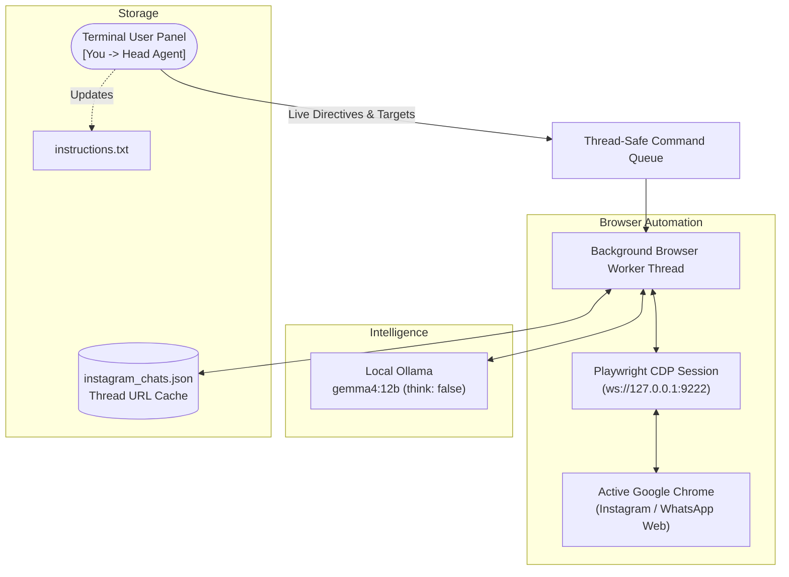

# 🤖 Agentic Social Messenger Bot (Gemma 4 Dedicated)

A fully local, privacy-focused automated messaging assistant powered by **Gemma 4** (`gemma4:12b`) on **Ollama** and connected to your active desktop browser session via **Chrome DevTools Protocol (CDP)**.

Supports automated chatting, context memory, and live interactive supervision for **Instagram Direct** and **WhatsApp Web**.

---

## ⚡ Highlights

- **Zero-Login / No 2FA Hassle:** Attaches to your existing Chrome profile via CDP. It never asks for passwords, handles cookies, or requires QR scans if you are already logged in.
- **100% Local Inference:** Runs entirely on your local GPU/CPU via Ollama (`gemma4:12b`). No external API keys or cloud services required.
- **Sub-2s Responses:** Fast generation with disabled chain-of-thought overhead (`"think": false`) and capped output tokens for snappy conversational speed.
- **Geometric Alignment Bubble Detection:** Automatically separates outgoing vs. incoming messages based on horizontal screen geometry—making it immune to CSS class obfuscation on both WhatsApp and Instagram.
- **Self-Reply & Echo Protection:** Keeps in-memory sent history and geometric checks to ensure the bot never replies to its own messages.
- **Thread URL Caching:** Discovers Instagram contacts via the Direct inbox and caches direct thread IDs (`/direct/t/<id>/`) locally for instant navigation on subsequent launches.
- **Rolling Context Memory:** Retains the last 15 conversation exchanges in a rolling sliding window to maintain natural continuity across turns.
- **Tone-Driven Persona Engine:** Uses a behavioral tone profile with repeat penalties (`repeat_penalty: 1.25`) and dynamic burst cadence (1–4 rapid bubbles) so replies adapt directly to context without parroting canned sentences.
- **Live Interactive Terminal Panel:** Update instructions on the fly (`[You -> Head Agent] > ...`), switch active contacts (`/target <username>`), or check status (`/status`) without restarting.

---

## 🏛️ Architecture



---

## 📋 Prerequisites

1. **Google Chrome** launched with remote debugging enabled:
   ```bash
   google-chrome --remote-debugging-port=9222 &
   ```
2. **Ollama** installed with `satgeze/gemma4-12b-uncensored-1.5m:latest`:
   ```bash
   ollama serve
   ollama pull satgeze/gemma4-12b-uncensored-1.5m:latest
   ```
3. **Python 3.10+** with required packages:
   ```bash
   pip install -r requirements.txt
   ```

---

## 🚀 Quick Start

1. **Launch the bot:**
   ```bash
   ./run.sh
   ```

2. **Interactive Setup:**
   * **Platform:** Enter `instagram` (default) or `whatsapp`.
   * **Target:** Enter the handle or contact name (e.g. `akxrv`, `pickle_rick_spamzz`, or `sharika`).
   * **Directive:** Enter your goal for the conversation (e.g. *"ask how he is and how's life in casual English"*).

3. **Live Panel Commands:**
   * Type any new goal to change conversation strategy live:
     ```text
     [You -> Head Agent] > tell him I have to leave for the gym in 5 mins
     ```
   * Switch contacts without restarting:
     ```text
     [You -> Head Agent] > /target another_user
     ```
   * Check active state:
     ```text
     [You -> Head Agent] > /status
     ```
   * Detach and exit cleanly:
     ```text
     [You -> Head Agent] > exit
     ```

---

## 🧪 Testing

Run the included unit test suite covering doubt regex matching, screen alignment math, and URL cache serialization:
```bash
python3 tests/test_agent.py
```

---

## 📂 Project Structure

```
├── adapters/
│   ├── base.py              # Platform adapter interface
│   ├── instagram.py         # Instagram Direct adapter (New message search, URL caching)
│   └── whatsapp.py          # WhatsApp Web adapter (Sidebar search, geometric alignment)
├── tests/
│   └── test_agent.py        # Unit tests
├── browser_agent.py         # Main agent loop, context memory, and Ollama integration
├── config.py                # Configuration, model settings, and doubt triggers
├── main.py                  # Thread-safe CLI panel and CDP worker
├── requirements.txt         # Dependencies (playwright, requests)
├── run.sh                   # Startup verification and runner script
└── README.md
```
